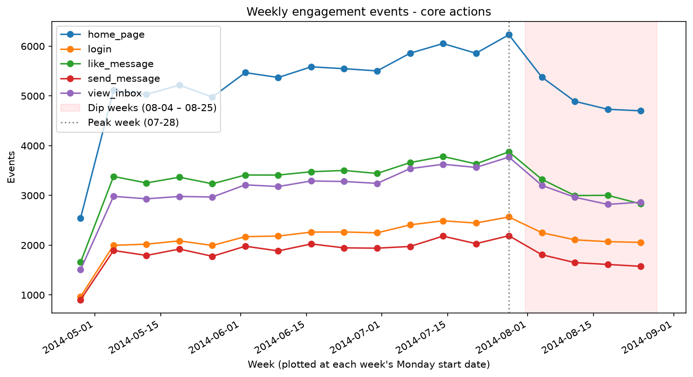
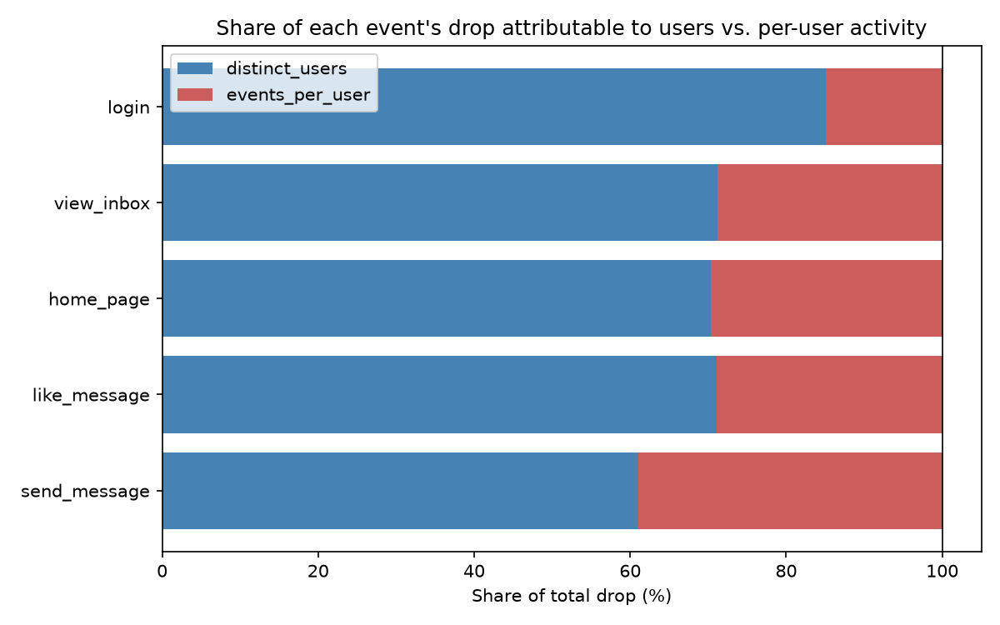
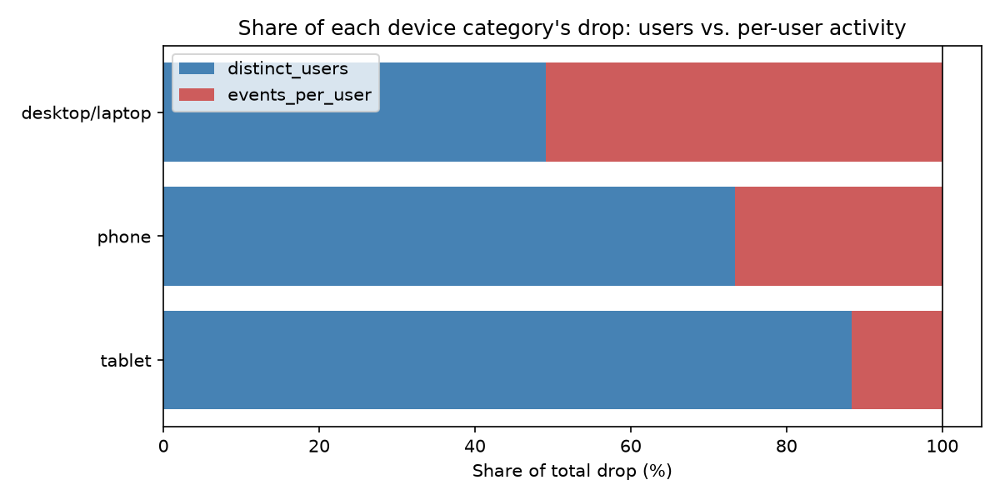
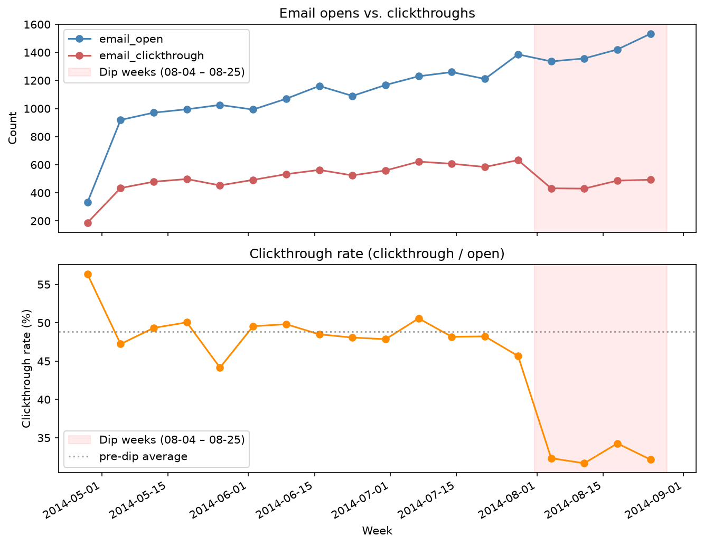
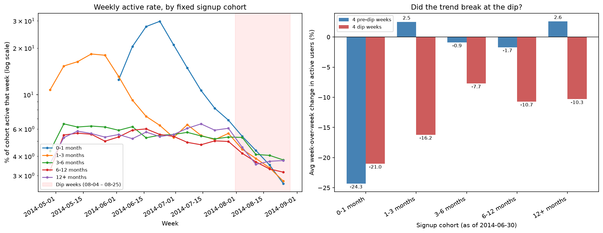
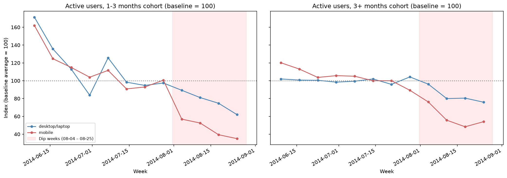

# Yammer Engagement Drop — Case Study

Investigating ThoughtSpot tutorial 'A Drop in Engagement' via SQL and Python - sudden decline in Yammer user engagement starting the week of 2014-08-04.

**Tools:** SQL (window functions) → Pandas (validation, metrics, log-growth
decomposition) → matplotlib (figures). See [`notebook/analysis.ipynb`](notebook/analysis.ipynb)
for the full step-by-step exploration, including every hypothesis tested.

---

## Key findings

Weekly engagement on the five **core events** (`home_page`, `login`,
`like_message`, `send_message`, `view_inbox` — the five highest-volume events,
and the only non-search ones) fell **roughly 13–20% below their pre-dip level**
starting the week of 2014-08-04 and never fully recovered within the observed
window. The week of 07-28 was the series peak; 08-04 is the first week
with lower volume. See the notebook for how "core" was defined.



*In this write-up, "platform" refers to all engagement events (all 17 event types, all users, all devices); the five core events comprise 87% of platform events.*

Examining the events by *fewer distinct users* vs. *lower per-user
activity* shows the drop is **mostly a "fewer users" engaging problem**, not
users doing less:



That pattern is clearer once engagement is split by **device
category**. *Phone and tablet activity dropped severely*
(73-88% of their drops are due to fewer users engaging), while desktop/laptop users engaged slightly less (an even 49/51 split):



A separate signal appears in the email data. Email **open**
volume kept growing throughout the dip, but the **clickthrough rate**
(clickthrough events ÷ open events) decreased from a ~48% baseline to ~33% starting the
exact same week, and unlike raw engagement, it shows **no recovery** at
all through 08-25:



This shows that emails were still sent. Open events held up, but clicks themselves fell about 32%
in the first dip week, so far fewer openers went on to click
through. The email data has no device or email-type breakdown, so the issue can't be traced further: 
a broken landing experience, a change to the emails' links or layout, or
a click-tracking problem would all appear the same. It is consistent with
either explanation in the conclusion below.

The loss also comes from **existing users**. Following fixed signup cohorts
(users bucketed by account age on 2014-06-30, then tracked through the dip),
every cohort older than one month shows a change at the dip: active users
were roughly flat in the weeks before it, then fell about 8–16% per week
(left: weekly active rate; right: average weekly change in active users, before
vs. during the dip). For cohorts older than three months the drop is almost
entirely due to *fewer active users*, not less activity per user.
Meanwhile, events from users who signed up after 06-30 held steady at
roughly 8,000 per week through the dip, while the fixed cohorts fell
about 40%, which masked part of the decline in platform totals (see the
notebook's "New signups offset part of the decline" table):



Crossing the two buckets (existing-user cohorts × device) shows the picture is
broader than just "mobile broke": established users on **both** mobile and desktop
broke at the dip. Mobile fell further and more sharply at the onset, though it
was also already decreasing before the dip. The platform-level desktop figure which 
showed only -8% was masked by the activity of new signups; among existing users, desktop
events fell 29% (mobile: 54%):



**Conclusion:** the drop is driven by existing users no longer showing up, on
every device, with **mobile hit hardest**. That fits a mobile-specific failure
on top of a broader problem, or one broad disruption that mobile users were
more exposed to, and the data can't distinguish which one. In addition, the email clickthrough
collapse is consistent with either. Therefore, the most actionable next step is
investigating what changed in the product (the mobile app, notification links,
and shared backend) around the week of 2014-08-04.

---

## Hypotheses tested

| # | Hypothesis | Verdict | Evidence |
|---|---|---|---|
| 1 | Holiday / seasonal effect | **Ruled out** | The drop is spread across countries and regions: US -16.3% vs. all other countries -17.2%; Europe -17.3%, Americas -18.1%, Asia-Pacific -18.7% |
| 2 | Site/server/button bug | **Not ruled out: mobile hit hardest, but not mobile-only** | No single device shows an isolated crash pattern. Phone/tablet fell much harder than desktop, but established desktop users also broke |
| 3 | Users concentrated in one location | **Ruled out** | US is 28% of volume and 27% of events lost; it would have needed to fall about 61% on its own to explain the aggregate drop, vs. 16.3% observed |
| 4 | Drop in new signups | **Ruled out** | Signups grew throughout the period, hitting an all-time high by 2014-08-25 |
| 5 | Email notifications stopped sending | **Ruled out** (sending volume), **but clickthrough rate decreased** | Send/open volume unaffected — but clickthrough *rate* independently collapsed with no recovery |

---

## Repo structure

```
├── README.md
├── sql/                          # one query per CSV export
│   ├── weekly_engagement.sql     # -> data/yammer_weekly_engagement.csv
│   ├── device_category.sql       # -> data/yammer_device_category.csv
│   ├── emails_events.sql         # -> data/yammer_emails.csv
│   ├── signups_weekly.sql        # -> data/yammer_signups.csv
│   ├── location_weekly.sql       # -> data/yammer_location_weekly.csv
│   ├── cohorts.sql               # -> data/yammer_cohorts.csv
│   └── cohort_device.sql         # -> data/yammer_cohort_device.csv
├── data/
│   ├── yammer_weekly_engagement.csv       # raw Mode exports (inputs, committed)
│   ├── yammer_device_category.csv
│   ├── yammer_emails.csv
│   ├── yammer_signups.csv
│   ├── yammer_location_weekly.csv
│   ├── yammer_cohorts.csv
│   ├── yammer_cohort_device.csv
│   ├── yammer_weekly_engagement_clean.csv # generated by scripts 01, 02, 04 (gitignored)
│   ├── yammer_events_per_user.csv
│   └── yammer_device_category_clean.csv
├── scripts/
│   ├── 01_validate_data.py       # load, validate, trend + pct-change plots
│   ├── 02_events_per_user.py     # fewer users vs. lower per-user activity
│   ├── 03_users_vs_intensity.py  # exact log-growth share decomposition
│   └── 04_device_category.py     # same decomposition, by device category
│   (all-events check, email, signups, location, cohort, and cohort × device analyses
│    live in the notebook -- no script versions)
├── figures/                      # all committed; generated by the scripts and the notebook
├── notebook/
│   └── analysis.ipynb            # full analysis walkthrough, all plots + SQL
└── requirements.txt
```

## Reproducing this analysis

1. Run each query in `sql/` against Mode's `tutorial` schema
   (`yammer_events`, plus `yammer_emails` and `yammer_users` for the email,
   signup, and cohort checks) and export the result as a CSV into `data/`,
   using the file names listed in the repo structure above.
2. `pip install -r requirements.txt`
3. Scripts (core events and device category only). From the repo root, run
   `python scripts/01_validate_data.py`, then `02`, then `03`; each of these
   reads the previous script's output. `04_device_category.py` is independent:
   it reads `data/yammer_device_category.csv` directly and can be run at any
   time. All four overwrite their outputs, so they are safe to rerun.
4. Notebook: open `notebook/analysis.ipynb` for the complete analysis (the
   scripts' steps plus the all-events check, email, signups, location, cohort,
   and cohort × device sections). It reads only the raw CSVs in `data/`, not
   the script outputs, and writes four of the README's figures to `figures/`.
